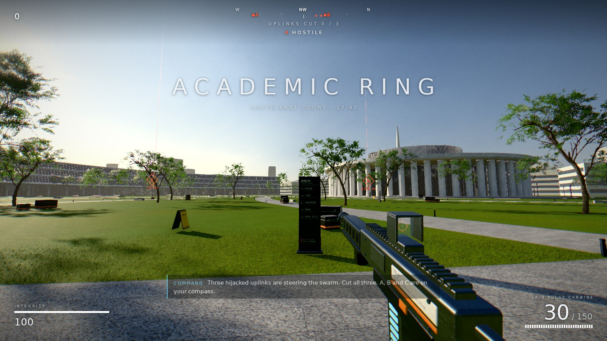
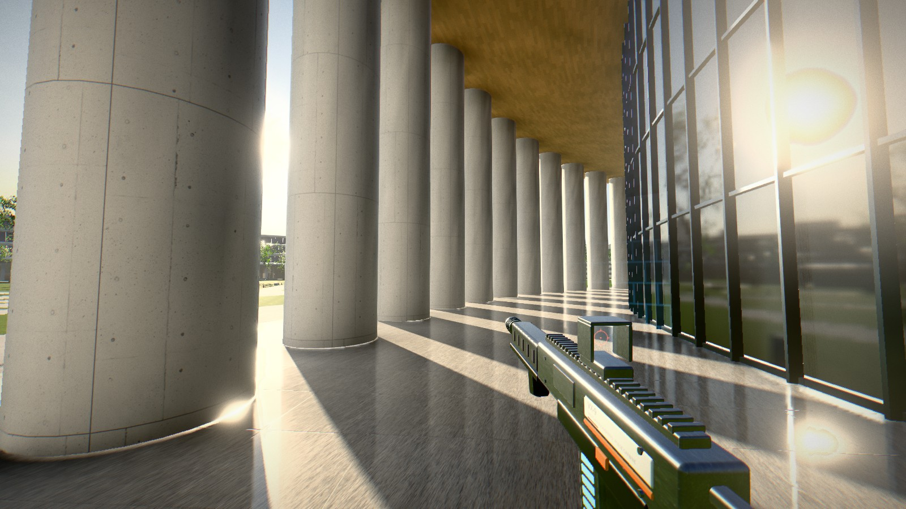
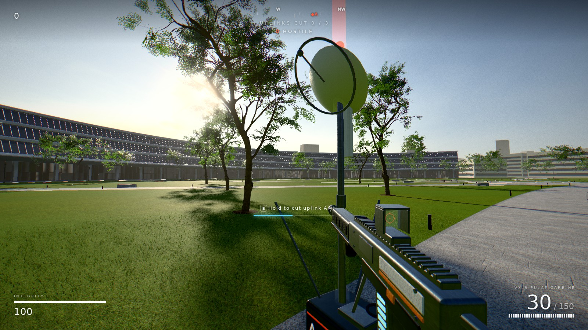

# RING ZERO

A small first-person shooter set in the courtyard of the **Academic Ring** on Westlake University's
**Yungu Campus** (西湖大学云谷校区), Hangzhou. It runs in the browser (WebGL 2, three.js).

17:42. The Engineering School's swarm-robotics test fleet has stopped answering its operators.
Three hijacked uplink masts (A, B, C) around the south-east court are steering the swarm. Follow
your compass, cut each one (hold `E`; taking a hit breaks the cut), and command talks you through
it over the radio. Reinforcements keep arriving while an uplink is live; cutting the third brings
the Warden. Clear the sky to secure the Ring, then keep fighting in endless mode if you like.

Enemies are drones only. This is an unofficial fan project and is not affiliated with Westlake University.





The screenshots in `docs/` were rendered on a GPU-less server with a software rasteriser (no
anisotropic filtering), so a real GPU looks sharper than they do.

**Play it online: <https://wzsyyh.github.io/iWestlake/>** (about 50 MB to download on first visit).

## Run it

**Offline: build the single file.** `npm run single` writes `RING-ZERO_西湖大学云谷校区.html` (52 MB),
which contains the whole game: code, textures, sky, models and baked lighting. Copy it to a machine
with a GPU and double-click it (Chrome, Edge or Firefox). No server and no install.

**Or serve the multi-file build** (sharper 4K sky, faster to load over a network). Requires Node 20+:

```bash
npm install
npm run build
npm start            # serves the built game on http://<this-machine>:4173
```

For development use `npm run dev` (port 5173). If the machine you build on has no display, forward
the port (`ssh -L 4173:localhost:4173 <host>`) and open `http://localhost:4173` locally.

Press **DEPLOY / 开始行动** on the title screen (mouse capture and audio need a click).

| Key | Action |
| --- | --- |
| `W A S D` | move |
| Mouse | aim; left button fires, right button aims down the sight |
| Arrow keys or `I J K L` | turn (keyboard look) |
| `Shift` / `Space` / `Ctrl` | sprint / jump / crouch |
| `E` (hold) | cut an uplink |
| `R` | reload |
| `Esc` | pause |
| `F3` | frame-rate and draw statistics |

- **Gamepad** (standard mapping): left stick move, right stick look, RT fire, LT aim, A jump,
  B crouch, X reload, Y cut uplink, L3 sprint, Start pause.
- **Touch screens**: the first touch switches on a virtual stick, drag-to-look and on-screen
  buttons, and phones / tablets start on the Low preset.
- **No mouse capture?** In sandboxed previews and some embedded viewers the browser refuses pointer
  lock. The game notices and switches to free-look: the view turns as the mouse moves over the game,
  keeps turning while the cursor rests near a screen edge, and the arrow keys always work.
- **Language**: English / 简体中文, chosen from the browser language and switchable on the title
  screen (or `?lang=zh` / `?lang=en`).
- **Graphics quality** (Low / Medium / High / Ultra), sensitivity, field of view and volume are on
  the title screen. Changing quality reloads the page. Start at **High**; drop to Medium if `F3`
  shows less than ~50 fps, or try Ultra (4x MSAA, 4K shadow cascades, native resolution).

## What is in the level

The geometry is procedural, laid out from HENN's published master plan and photographs:

- **The Academic Ring**: 225 degrees of it at true scale (155 m radius): the granite promenade, the deep white
  canopy, the ground-floor curtain wall with piers and mullions, and three stepped-back glazed tiers.
- **The Academic Hall**: glazed drum, 64 monumental columns, bamboo-lined soffit, polished stone
  gallery, ribbed upper drum.
- The lawns with their leaf-vein paths, 128 trees, lamp posts, bollard lights, stone benches and
  bilingual wayfinding totems; the campus buildings north of the open arc, the tower, the city and
  the hills beyond.

The playable area is the fenced south-east court (about 150 m across); the rest of the ring is scenery.

## How it is rendered

- **Lighting**: a Poly Haven HDR sky is analysed at load: the sun is located, measured and removed
  from the ambient map, and becomes a real-time light with four cascaded shadow maps.
- **Soft shadows**: percentage-closer soft shadows with a blocker search, so penumbrae widen with
  distance from the occluder (crisp at the foot of a column, soft under a tree canopy).
- **Baked global illumination**: `tools/bake.mjs` rebuilds the level in Node and solves sky light
  plus four bounces of sunlight per vertex (BVH ray casting, sparse radiosity). The result ships as
  `public/assets/bake.bin` (1.2 MB) and replaces the ambient term in the material shaders.
- **Reflections**: a prefiltered cube probe captured from the court at start-up; every curtain-wall
  pane has its own slight tilt and bulge so reflections break up per pane like real glazing. The
  Hall's polished gallery floor gets a true planar reflection (the scene re-rendered from the
  mirrored camera) on High and Ultra while you are near it.
- **Materials**: CC0 photo-scanned PBR textures, extended in-shader with procedural stone joints
  (random slab lengths, per-slab texture offsets so nothing visibly tiles), panel seams and
  large-scale weathering.
- **Vegetation**: a photoscanned Poly Haven tree (2 M triangles) is re-authored by
  `tools/build_tree.py` into leaf cards + simplified wood at three LODs, with wind, leaf
  translucency and tiled shadow proxies; mown-grass blades are instanced around the camera.
- **Post**: HDR pipeline with N8AO ambient occlusion, depth-reprojection motion blur, bloom, light
  shafts, Khronos Neutral tone mapping, grade, SMAA, grain; eye adaptation between sun and shade.
- **Audio** is synthesised at run time (no sample files).

## Project layout

```
src/engine/   renderer + post chain, sky analysis, shader-extension framework, reflection probe
src/world/    layout constants, procedural architecture, ground, props, trees, grass, GI bake
src/game/     player, weapon, drones, uplink mission, effects, audio, HUD, i18n, game director
tools/        asset pipeline, offline bake, headless screenshot and bot-playtest drivers
public/assets textures, sky, tree model, baked lighting
```

Useful commands:

```bash
npm run single      # build + pack everything into the one-file HTML
tools/deploy_pages.sh <owner>   # rebuild and publish: source -> main, built game -> gh-pages
npm run bake        # re-bake lighting; REQUIRED after any change to level geometry
npm run assets      # re-download and re-process the CC0 source assets (Python 3 + Pillow, numpy, scipy, fast-simplification)
npm run playtest    # a bot plays the whole mission headlessly and reports errors (needs Playwright + Chromium)
```

If `bake.bin` does not match the geometry, the game still starts but falls back to a slower,
lower-quality bake in the browser and logs a warning.

## Credits and licences

- Campus design: **HENN** with UAD (Westlake University Yungu Campus master plan, Academic Ring,
  Academic Hall). The level is an interpretation from published drawings and photographs.
- Sky `qwantani_late_afternoon_puresky`, textures `concrete_wall_008`, `plastered_wall_04`,
  `bamboo_veneer`, `farm_soil` and model `tree_small_02`: [Poly Haven](https://polyhaven.com), CC0.
- Textures `Granite002A`, `Grass004`, `Grass005`, `Metal009`, `Metal032`, `Metal038`,
  `Plastic006`, `Plastic010`, `Fabric004`: [ambientCG](https://ambientcg.com), CC0.
- Libraries: three.js, pmndrs/postprocessing, n8ao, three-mesh-bvh (MIT).
